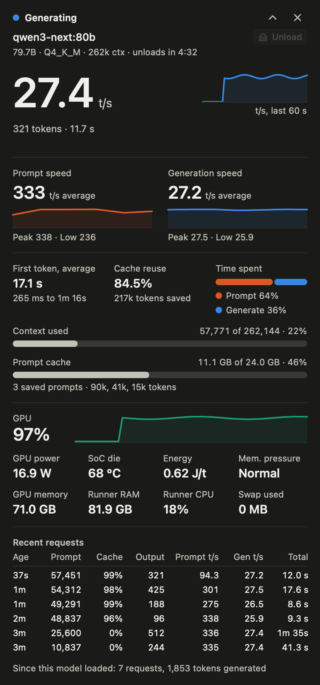

# Ollameter

A menu bar gauge and an always-on-top window for [Ollama](https://ollama.com) on Apple Silicon Macs. It shows live tokens per second, how far along a prompt is, GPU load and power, context and prompt cache use, and the timings of recent requests.



## What it shows

- **Menu bar:** a ring for GPU load, which fills with prompt progress while a long prompt is read, and the live tokens per second.
- **Window:** generation and prompt speed, time to first token, cache reuse, context and prompt cache fill, GPU power and temperature, memory pressure and recent requests. The chevron switches to a compact view with just the headline numbers.
- **Unload button:** frees the loaded model's memory without waiting for its keep-alive to run out. It asks for a second click, since reloading a large model and rereading its prompts takes a while, and it's disabled while the model is working.

Left-click the menu bar icon to show or hide the window. Right-click it for the menu.

## Requirements

- An Apple Silicon Mac with macOS 14 or later.
- Ollama on this Mac at `127.0.0.1:11434`. Only models on Ollama's llama.cpp runner are measured; a model on the MLX runner reads as idle.

## Install

Download the zip from [Releases](../../releases), unzip it and move `Ollameter.app` to Applications.

The app isn't notarized, so macOS blocks the first launch. Either open it once, then click **Open Anyway** in System Settings → Privacy & Security, or run:

```sh
xattr -dr com.apple.quarantine /Applications/Ollameter.app
```

## Where the numbers come from

Ollameter needs no special permissions.

- **llama-server's `/slots` endpoint** gives per-token counts while a request runs. Ollama starts llama-server on a random port, which Ollameter reads from the process list.
- **`~/.ollama/logs/server.log`** gives each prompt's size and progress, final timings and the prompt cache's state.
- **Ollama's `/api/ps`** lists loaded models. It's polled sparingly, because every call adds a line to the server log.
- **IOReport and IOHID** give GPU power and the SoC die temperature.

## Build

```sh
swift test
scripts/build-app.sh
open build/Ollameter.app
```

Two flags help when changing the UI:

- `--render DIR` writes PNGs of every window state from sample data, in light and dark mode. Add `--live` to include one from this Mac.
- `--self-test DIR --seconds N` runs the real app for N seconds, records every frame it publishes, drives the window and menu bar item, and writes a report. `--unload-test MODEL` also clicks the unload button, and only acts if MODEL is the only model loaded.

## Releases

Push a tag such as `v0.2.0` and the Release workflow tests, builds and publishes it. A tag with a hyphen, such as `v0.2.0-beta.1`, becomes a prerelease. Running the workflow by hand from the Actions tab does the same build and attaches the zip to the run without publishing anything.
